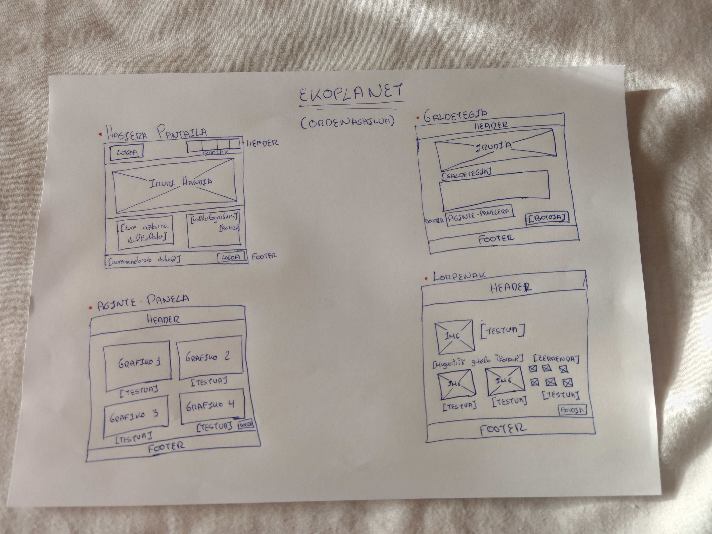
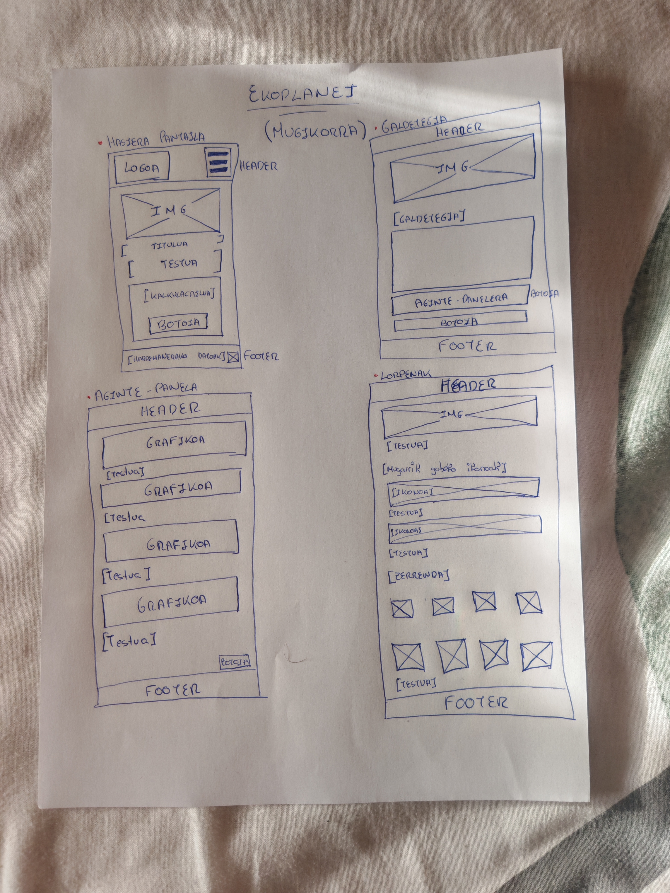
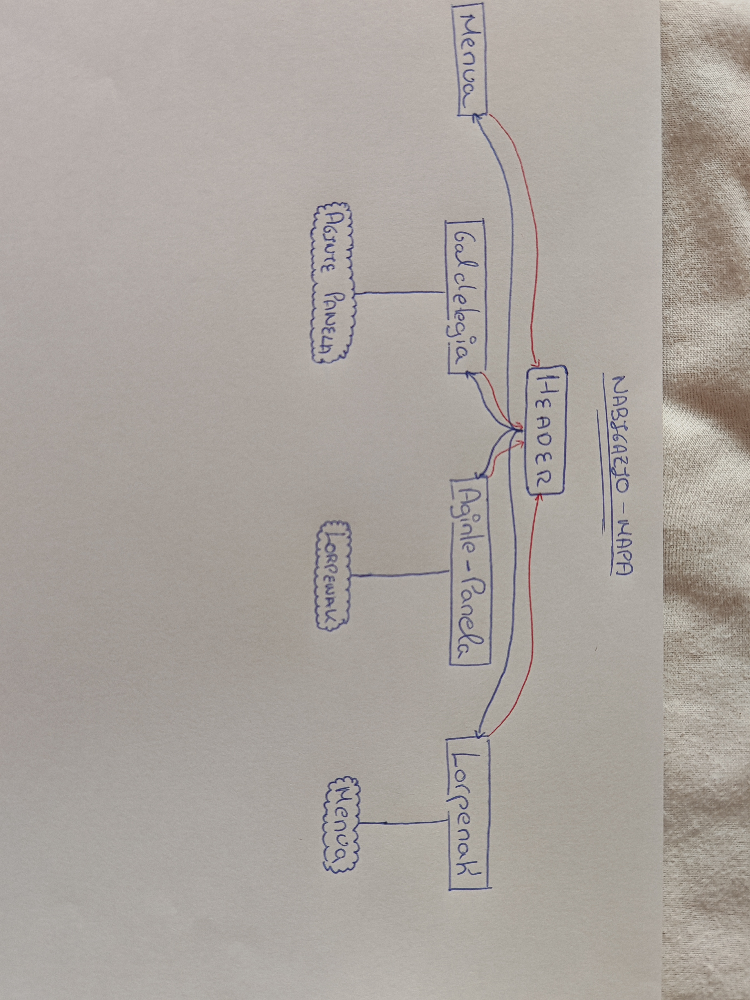

# Ekoplanet- HARKAITZ FERREIRA  
Zure etxeko kontsumoa jakiteko webgunea.

 

## Aurkibidea

1. [Sarrera](#1-sarrera)
2. [Lehiakideak eta Balio Ekarpena](#2-lehiakideak-eta-balio-ekarpena)
3. [Erabiltzaile Profila (User Profile)](#3-erabiltzaile-profila-user-profile)
4. [Krokisa / Diseinua](#4-krokisa--diseinua)
   4.1. [Ordenagailuko Bertsioa (Desktop)](#41-ordenagailuko-bertsioa-desktop)
   4.2. [Mugikorreko Bertsioa (Mobile)](#42-mugikorreko-bertsioa-mobile)
5. [Nabigazio Mapa](#5-nabigazio-mapa)
6. [Estilo - Gida](#6-estilo---gida)
   6.1. [Koloreak](#61-koloreak)  
   6.2. [Tipografia](#62-tipografia)  
   6.3. [Botoiak](#63-botoiak)  
   6.4. [Irudiak](#64-irudiak)  
   6.5. [Ikonoak](#65-ikonoak)  
7. [Prototipoa](#7-prototipoa)
8. [Edukien Lizentzia](#8-edukien-lizentzia)
9. [Erabilgarritasunaren Azterketa](#9-erabilgarritasunaren-azterketa)
10. [Bibliografia eta Webgrafia](#10-bibliografia-eta-webgrafia)

 

## 1. Sarrera

Gaur egun, funtsezkoa da gure ingurumen-eragina ezagutzea eta etxean energia gutxiago kontsumitzea. Proiektu honen helburua web-plataforma bat sortzea da, erabiltzaileei beren karbono-aztarna kalkulatzen eta etxebizitzan energia aurrezten laguntzeko, aholku pertsonalizatuen bidez.

Erabiltzailearen esperientzia hobetzeko, webguneak ezaugarri nagusi hauek ditu:

- **Galdetegi interaktiboak:** Datuak erraz sartzeko.
- **Aginte-panela (Dashboard) eta grafikoak:** Emaitzak eta bilakaera bisualki ikusteko.
- **Lorpen-sistema (Gamifikazioa):** Erronkak gainditzen diren bitartean ohitura jasangarriak bultzatzeko.

Helburua trantsizio ekologikoa modu erraz eta praktikoan sustatzea da.

## 2. Lehiakideak eta Balio Ekarpena

### Lehiakide zuzenak
- **[Giki Zero](https://zero.giki.earth/)**: Karbono-aztarna kalkulatzen du galdetegi erraz batzuen bidez, eta lorpenak zein gomendioak ematen ditu.
- **[Ecologi](https://ecologi.com/)**: Karbono-isuriak gutxitzeko eta zuhaitzak landatzeko webgunea da, panel oso bisualekin eta intsigniekin.
- **[JouleBug](https://joulebug.com/)**: Etxean energia aurrezteko aplikazioa da, eguneroko erronken eta dominen bidez motibatzen duena.

### Ondorioak: Ekoplanet plataformaren abantailak
- **Denak leku bakarrean:** Beste webgune batzuek gauza bakarra egiten dute (adibidez, aztarna orokorra kalkulatu edo erronka puntualak jarri). Gure plataformak, berriz, bi gauzak batera egiten ditu aginte-panel (*dashboard*) bakar batean: karbono-aztarna kalkulatu eta etxeko energia-kontsumoa aztertu.
- **Grafiko errazak eta joko-sistema:** Informazioa grafiko oso argiekin erakusten dugu. Gainera, lorpen-sistema bati esker, erabiltzaileak galdetegiak erantzun ditzake eta ohitura berdeak lortu ditzake modu oso erraz eta intuitiboan.

## 3. Erabiltzaile Profila (User Profile)

### Nori zuzenduta dago webgunea?
Gure plataforma batez ere **gazteei eta heldu gazteei (18-35 urte)** zuzenduta dago, beren etxean bizi direnak edo pisua partekatzen dutenak. Pertsona hauek ingurumenarekin konprometituta daude eta teknologia egunero erabiltzen dute.

### Zergatik profil hau?
- **Teknologia eta gamifikazioa gogoko dituzte:** Errazago erabiltzen dituzte aplikazio interaktiboak, grafikoak eta sari-sistemak.
- **Fakturak eta energia aurreztu nahi dituzte:** Etxean independenteak izaten hasten direnez, garrantzitsua da guretzat dirua eta energia nola aurreztu ikastea.
- **Ingurumenarekiko kontzientzia dute:** Beren karbono-aztarna murriztu nahi dute, baina modu erraz, praktiko eta azkar batean egin nahi dute, testu luzeegiak irakurri gabe.

## 4. Krokisa / Diseinua

Plataformaren interfazearen egitura eta diseinu bisuala definitzeko, croquis desberdinak garatu dira, ordenagailuko eta mugikorreko bertsioetarako egokituta:

### 4.1. Ordenagailuko Bertsioa (Desktop)

### 4.2. Mugikorreko Bertsioa (Mobile)

## 5. Nabigazio Mapa

Webgunearen barne-egitura eta orrien arteko konexioa hobeto ulertzeko, nabigazio-mapa garatu da. *Header* nagusiaren bidez erabiltzaileak atal nagusi guztietara (Galdetegia, Aginte-Panela, Lorpenak eta Menua) bideratu daiteke modu azkar eta intuitiboan.

## 6. Estilo - Gida

### 6.1. Koloreak

| Funtzioa | Kolorea | Hex | Erabilera |
| :--- | :--- | :--- | :--- |
| **Nagusia** | Baso Berdea | `#1E5631` | Botoi nagusiak (*[HASI ORAIN]*), logotipoa |
| **Bigarren mailakoa** | Menta Berdea | `#2ECC71` | Gamifikazioa, intsigniak, aurrerapen-barrak |
| **Azentua** | Ura Urdina | `#3498DB` | Kontsumo energetikoaren grafikoak |
| **Nabarmendua** | Anbar Horia | `#F1C40F` | Aholkuak eta lorpen-oharrak |
| **Atzeko planoa** | Gris Argia | `#F4F6F7` | Blokeko eta ataleko bereizleak |
| **Testua** | Antrazita Grisa | `#2C3E50` | Tituluak eta testu nagusia |

### 6.2. Tipografia

Webguneak **Inter** edo **Roboto** tipografia sans-serif modernoak erabiliko ditu. Serif gabeko letra-tipo hauek garbiak, irakurgaitz errazak eta azkarrak dira mugikor zein ordenagailu pantailetan.

| Erabilera | Tamaina | Ezaugarria |
| :--- | :--- | :--- |
| **Tituluak** | 24px - 32px | Modernoa eta nabarmendua |
| **Testu Nagusia** | 14px - 16px | Irakurgarritasun handikoa pantailetan |
| **Botoiak** | 14px - 16px | Argia eta ekintzara bideratua |

### 6.3. Botoiak
Ekoplanet webgunean hiru botoi mota nagusi erabiliko dira, erabiltzailearen ekintzak argi bideratzeko eta interfaze intuitiboa izateko:

- **Botoi Nagusia:** Baso Berdea (`#1E5631`) atzeko planoarekin eta testu zuriarekin. Webguneko ekintza garrantzitsuenetarako erabiltzen da, hala nola galdetegia hasteko (*[HASI ORAIN]*) edo inprimakiak bidaltzeko (*[BIDALI]*).

- **Bigarren Mailako Botoia:** Menta Berdea (`#2ECC71`). Aukera osagarrietarako erabiltzen da, hala nola atzera egiteko (*[AURREKOA]*), xehetasunak ikusteko (*[IKUSI GEHIAGO]*) edo bigarren mailako ekintzetarako.

- **Gamifikazio eta Interakzio Botoia:** Anbar Horia (`#F1C40F`) edo Ura Urdina (`#3498DB`). Erronkak aktibatzeko (*[EGIN ERRONKA]*), aholkuak aplikatzeko (*[APLIKATU AHOLKUA]*) edo sariak ikusteko erabiltzen da.

### 6.4. Irudiak

Ekoplanet webgunean erabiliko diren irudi nagusiak eta ikonoak honako hauek dira:

- **Argazki Nagusia:**
  * **Tamaina:** Handia (1920 x 1080px / 1080 x 1080px).
  * **Non jarri:** Hasierako orriaren goiko aldean.
  * **Nolakoa:** Ingurumenarekin lotutako irudi edo marrazki garbia eta erakargarria.

- **Ikonoak:**
  * **Tamaina:** Txikia (64 x 64px).
  * **Non jarri:** Tituluen ondoan edo txartelen barruan (adibidez: argindarra, ura edo CO2-a adierazteko).
  * **Nolakoa:** Marrazki sinpleak eta erraz ulertzeko modukoak.

- **Sariak eta Dominak:**
  * **Tamaina:** Ertaina (256 x 256px).
  * **Non jarri:** Lorpenen atalean.
  * **Nolakoa:** Erronkak gainditzean lortzen diren domina koloretsuak.

- **Aholkuen Argazkiak:**
  * **Tamaina:** Ertaina (600 x 400px).
  * **Non jarri:** Aholku bakoitzaren goiko aldean.
  * **Nolakoa:** Etxean energia aurrezteko adibideak erakusten dituzten argazki laburrak.
 
### 6.5. Ikonoak

Interfazean zehar erabilitako ikono minimalistak eta intuitiboak, erabiltzailearen orientazioa errazteko eta atal bakoitzaren esanahia irudi bidez indartzeko.

 

## 7. Prototipoa

Proiektuaren azken diseinua (fidelitate altuko prototipoa) erabiltzailearen esperientzia (UX) eta interfazea (UI) ardatz hartuta garatu da. Sistemaren funtzionalitate nagusiak pantaila hauetan banatu dira:

* **Hasiera orria (Landing Page):** Proiektuaren balio-proposamena aurkezten du "Zaindu planeta. Aurreztu etxean." mezuarekin. Erabiltzailea ekintzara bideratzen duen "Kalkulatu nire aztarna" botoi nabarmena du.
* **Galdetegia:** Erabiltzailearen datuak eta etxebizitzaren ezaugarriak (adibidez, etxebizitza mota) jasotzeko interfaze sinple eta interaktiboa da. Prozesua pausoz pauso egiten da.
* **Aginte-panela (Dashboard):** Erabiltzaileari bere karbono-aztarnaren eta energia-kontsumoaren egoera erakusten dio modu grafiko eta argian. Asteko kontsumoaren bilakaera erakusten duten barra-grafikoak biltzen ditu, baita eguneroko aholku pertsonalizatuak ere.
* **Lorpenak eta Gamifikazioa:** Erabiltzaileak ohitura jasangarriak har ditzan motibatzeko atala da. Bertan, gainditutako erronkengatik lortutako dominak eta aurrerapen-barrak ikus daitezke.

[Prototipoa]([https://www.ejemplo.com](https://www.figma.com/make/0r0v6FhKgpSMp9HuU2GIn7/Ekoplanet-Prototipoa?code-node-id=0-6&p=f&t=FQo29dlsPhn0ZKn6-0&fullscreen=1))
 

## 8. Edukien Lizentzia

Proiektu honen garapena eta iturburu-kodea **MIT Lizentziapean** argitaratu dira. Horrek esan nahi du edozein garatzailek askatasunez erabili, aldatu eta banatu dezakeela kodea.

Webgunearen diseinu bisuala, testuak eta irudiak, berriz, **Creative Commons (CC BY-NC-SA 4.0)** lizentziapean daude. Lizentzia honek edukia partekatzea eta egokitzea ahalbidetzen du, baldin eta jatorrizko egiletza (Harkaitz Ferreira) aitortzen bada, helburu komertzialetarako erabiltzen ez bada, eta lan eratorriak baldintza berberekin banatzen badira.

 

## 9. Erabilgarritasunaren Azterketa

Prototipoa garatu ondoren, erabilgarritasun-azterketa (Usability Testing) bat burutu da gure xede-taldeko (18-35 urte) erabiltzaileekin, plataformaren efizientzia, argitasuna eta gogobetetasuna neurtzeko. Ateratako ondorio nagusiak hauek dira:

* **Nabigazio intuitiboa:** Erabiltzaileek oso modu errazean aurkitu dituzte galdetegia eta aginte-panela. *Header* nagusiak ondo bideratzen du nabigazioa.
* **Informazioaren argitasuna:** Aginte-paneleko datuak (karbono-aztarna eta energia-kontsumoa) grafikoki oso ondo ulertzen direla adierazi dute.
* **Gamifikazioaren arrakasta:** Erronken eta dominen sistemak jarrera positiboa piztu du probatzaileen artean, plataforma maizago erabiltzeko eta aholkuak aplikatzeko motibazioa sortuz.
* **Irisgarritasuna:** Aukeratutako kolore-paletak (Baso Berdea eta Antrazita Grisa atzealde argiekin) kontraste egokia bermatzen du pantaila mota ezberdinetan irakurgarritasuna errazteko.

 

## 10. Bibliografia eta Webgrafia

Proiektu hau diseinatu eta egituratzeko honako baliabideak erabili dira:

* **Diseinua eta Prototipatzea:** Figma.
* **Tipografia:** Google Fonts (Inter / Roboto).
* **Ikonoak eta Baliabide Bisualak:** Interfazearen liburutegi grafiko propioa eta stock-irudi libreak, baita IA generatutakoak.
* **Lehiakideen informazioa:** 
  * Giki Zero: [https://zero.giki.earth/](https://zero.giki.earth/)
  * Ecologi: [https://ecologi.com/](https://ecologi.com/)
  * JouleBug: [https://joulebug.com/](https://joulebug.com/)
